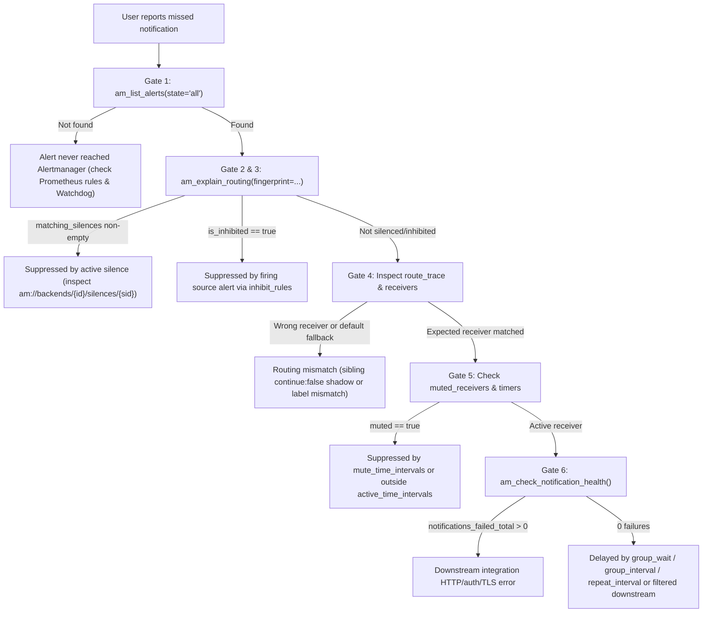

# Notification Pipeline Diagnostic Decision Tree

## Timing & Deduplication Nuances

- **`group_wait` (default `30s`)**: Initial buffer before sending the first notification for a newly created alert group.
- **`group_interval` (default `5m`)**: Minimum wait before sending a notification when a *new* alert is added to an *already-notified* group.
- **`repeat_interval` (default `4h`)**: Minimum wait before re-sending the exact same group if no alerts were added or resolved.
- **`send_resolved` (default varies by integration)**: If a brief spike resolved before `group_wait` elapsed, or if `send_resolved: false`, no recovery notification is sent.
