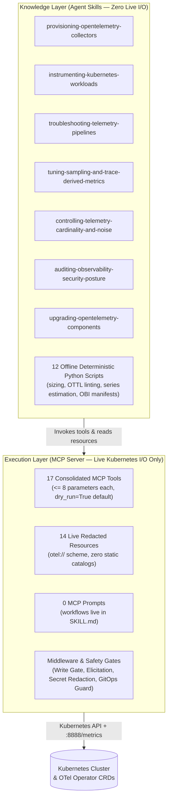

<p align="center">
  
</p>

<h1 align="center">OpenTelemetry MCP Server &amp; Agent Plugin</h1>

<p align="center">
  Production-grade OpenTelemetry on Kubernetes with strict <strong>Knowledge Layer (Agent Skills)</strong> and <strong>Execution Layer (MCP Server)</strong> separation — intent-driven collector provisioning, multi-language auto-instrumentation, single-call N→1 pipeline diagnostics, OTTL cardinality & PII governance, and security posture auditing.
</p>

<p align="center">
  <a href="https://pypi.org/project/talkops-opentelemetry-mcp-server/"></a>
  <a href="https://www.python.org/"></a>
  <a href="https://github.com/talkops-ai/talkops-mcp/blob/main/LICENSE"></a>
  <a href="https://modelcontextprotocol.io/"></a>
  <a href="https://opentelemetry.io/"></a>
</p>

---

## Architecture: Strict Knowledge vs. Execution Separation

In accordance with [Skill and Execution Separation](../../docs/skill-and-execution-separation.md), this package enforces a strict, testable boundary between **portable domain knowledge** and **live cluster execution**:



### Core Architectural Invariants
1. **Zero Static-Data Tools or Resources**: Static language matrices, topology calculators, and OTTL snippet generators live in `skills/*/references/` and `skills/*/scripts/` — never in MCP tools or resources.
2. **Zero MCP Prompts**: All multi-step operational runbooks live in `skills/<skill-name>/SKILL.md` with progressive disclosure.
3. **17 Focused Tools ($\le 8$ Parameters Each)**: High-cohesion N→1 tools (`otel_survey_cluster`, `otel_diagnose_collector`, `otel_verify_instrumentation`) replace fragmented single-check tools.
4. **Two-Phase Mutation Safety**: Every mutating tool defaults to `dry_run=True`, runs the pre-apply configuration linter (blocking `severity="error"` findings), detects GitOps ownership (`Argo CD`, `Flux`, `Helm`), snapshots previous configs to `otel.mcp/last-known-good`, and gates destructive operations behind MCP Elicitation / `confirm=True`.
5. **Mandatory Secret Redaction**: All tool and resource outputs strip `kubectl.kubernetes.io/last-applied-configuration` and `metadata.managedFields` and mask inline tokens/keys with `***REDACTED***` while preserving `${env:VAR}` placeholders.

---

## Execution Layer: 17 MCP Tools

| Toolset | Tool Name | Mode | Max Params | Purpose |
|---|---|---|---|---|
| `discovery` | `otel_survey_cluster` | Read-Only | 3 | Single-call cluster survey: Operator health, Collectors, Instrumentations, TargetAllocators, OpAMPBridges, eBPF agents, and discovered backends |
| `discovery` | `otel_list_workloads` | Read-Only | 5 | Scan `Deployment`, `StatefulSet`, and `DaemonSet` workloads with 4-tier language detection and instrumentation state (`instrumented`, `uninstrumented`, `broken`) |
| `ui` | `otel_query_a2ui` | Read-Only | 0 | TalkOps A2UI frontend datatable status aggregation |
| `collector` | `otel_provision_collector` | Write (`dry_run=True`) | 8 | Intent-driven Collector CRD + least-privilege RBAC provisioning (`agent`, `gateway`, `tail-sampler`, `all-in-one`) |
| `collector` | `otel_patch_collector` | Write (`dry_run=True`) | 7 | Create/patch Collector CRD with pre-apply config linting, unified diff, and snapshot persistence |
| `collector` | `otel_revert_collector_config` | Write (`dry_run=True`) | 4 | One-level rollback of a Collector CRD to its `otel.mcp/last-known-good` snapshot |
| `collector` | `otel_delete_resource` | Write (`dry_run=True`) | 5 | Delete `OpenTelemetryCollector`, `Instrumentation`, or `OpAMPBridge` CRDs with confirmation gate |
| `instrumentation` | `otel_patch_instrumentation` | Write (`dry_run=True`) | 8 | Create/patch `Instrumentation` CRD with pinned agent images and per-language OTLP protocol/port alignment (`:4317` gRPC for Java/Node.js, `:4318` HTTP for Python/.NET/Go) |
| `instrumentation` | `otel_manage_workload_instrumentation` | Write (`dry_run=True`) | 8 | Enable, disable, or rolling-restart workload auto-instrumentation across `Deployment`, `StatefulSet`, and `DaemonSet` |
| `instrumentation` | `otel_verify_instrumentation` | Read-Only | 3 | Single-call end-to-end verification of annotations, CR existence, pod initContainers, injected env vars, and restart timestamps |
| `pipeline` | `otel_configure_receivers` | Write (`dry_run=True`) | 6 | Wire `kubeletstats`, `hostmetrics`, `k8s_cluster`, `k8sobjects`, `filelog`, and `prometheus_ta` with volume mounts and RBAC |
| `pipeline` | `otel_configure_processing` | Write (`dry_run=True`) | 6 | Configure OTTL `transform` and `filter` processors for JSON parsing, PII masking, attribute dropping, and healthcheck noise filtering |
| `pipeline` | `otel_configure_sampling` | Write (`dry_run=True`) | 5 | Configure `head`, `probabilistic`, `tail` (with trace-affinity topology guard), or `none` sampling |
| `pipeline` | `otel_configure_connectors` | Write (`dry_run=True`) | 5 | Configure bounded `spanmetrics` and `servicegraph` connectors across `traces` and `metrics` pipelines |
| `diagnostics` | `otel_diagnose_collector` | Read-Only | 4 | Single-call N→1 diagnosis correlating CR status, pod OOM/CrashLoop state, Service endpoints, events, redacted logs, and `:8888/metrics` |
| `diagnostics` | `otel_validate_collector_config` | Read-Only | 5 | Deep static + live cluster validation (processor order, filelog safety, referential integrity, Secret refs, RBAC, v0.123+ deprecations) |
| `governance` | `otel_audit_security_posture` | Read-Only | 3 | Cluster-wide audit of inline secrets, unencrypted exporters, wildcard RBAC, and eBPF/OBI pod privileges |

---

## Execution Layer: 14 Live MCP Resources (`otel://`)

| Resource URI | Description |
|---|---|
| `otel://server/capabilities` | Server write mode (`allow_write`, `read_only`, `toolsets`), bound context, K8s connectivity, default Collector version |
| `otel://cluster/contexts` | Available kubeconfig contexts and active bound context |
| `otel://operator/status` | OpenTelemetry Operator pod health, webhook diagnostics, and per-namespace Instrumentation CR counts |
| `otel://collectors/{namespace}` | Summary list of `OpenTelemetryCollector` CRDs in `{namespace}` |
| `otel://collector/{namespace}/{name}` | Sanitized Collector CRD status, pipeline topology, and GitOps ownership |
| `otel://collector/{namespace}/{name}/config` | Redacted YAML configuration of `{name}` |
| `otel://collector/{namespace}/{name}/history` | Snapshot metadata and redacted preview from `otel.mcp/last-known-good` |
| `otel://k8s-enrichment/{namespace}/{collector}` | `k8sattributes` processor enrichment profile |
| `otel://logs-profile/{namespace}/{collector}` | `filelog` receiver, checkpoint storage, and log pipeline profile |
| `otel://spanmetrics/{namespace}/{collector}` | `spanmetrics` & `servicegraph` connector profile and cardinality estimate |
| `otel://sampling/{namespace}/{collector}` | Combined head + tail sampling profile |
| `otel://instrumentations/{namespace}` | Summary list of `Instrumentation` CRDs in `{namespace}` |
| `otel://instrumentation/{namespace}/{name}` | Sanitized `Instrumentation` CRD spec |
| `otel://target-allocator/{namespace}/{name}` | Target Allocator configuration, allocation strategy, and Prometheus CR selectors |

---

## Knowledge Layer: 7 Agent Skills & 12 Offline Scripts

| Skill Directory | Purpose | Bundled Offline Scripts (`scripts/`) |
|---|---|---|
| `skills/provisioning-opentelemetry-collectors` | Role-based Collector architecture (`agent`, `gateway`, `tail-sampler`, `all-in-one`), GOMEMLIMIT sizing, RBAC | `plan_collector_topology.py`, `render_collector_cr.py`, `lint_collector_config.py` |
| `skills/instrumenting-kubernetes-workloads` | Multi-language Operator auto-instrumentation, OTLP protocol alignment, Go/Rust OBI eBPF fallback | `lint_workload_manifest.py`, `render_instrumentation_cr.py`, `render_obi_manifest.py` |
| `skills/troubleshooting-telemetry-pipelines` | Evidence-first pipeline triage (`:8888/metrics`, OOMKilled, webhook failures, silent drops) | `analyze_internal_metrics.py` |
| `skills/tuning-sampling-and-trace-derived-metrics` | Head vs. probabilistic vs. two-tier tail sampling (`loadbalancing` exporter) + `spanmetrics`/`servicegraph` | `estimate_tail_sampling_capacity.py`, `render_tail_sampling_policies.py` |
| `skills/controlling-telemetry-cardinality-and-noise` | Metric series estimation, OTTL attribute dropping, healthcheck noise filtering, PII redaction | `render_ottl_statements.py` |
| `skills/auditing-observability-security-posture` | Secret redaction, TLS, least-privilege RBAC, Linux 5.8+ `CAP_BPF`/`CAP_PERFMON` eBPF auditing | `render_audit_report.py` |
| `skills/upgrading-opentelemetry-components` | Safe Collector/Operator upgrades (`v0.120+` pull metrics, `v0.123+` `debug` exporter, semconv migration) | `check_config_deprecations.py` |

---

## Getting Started & CLI Flags

### Run from Source
```bash
cd src/opentelemetry-mcp-server
uv sync

# Default safe mode (read-only by default unless --allow-write is passed)
uv run opentelemetry-mcp-server

# Enable cluster mutations (still protected by dry_run=True default and confirmation gates)
uv run opentelemetry-mcp-server --allow-write

# Bind to a specific kubeconfig context (multi-cluster pattern: one server entry per context)
uv run opentelemetry-mcp-server --context prod-us-east-1 --allow-write

# Expose only specific toolsets
uv run opentelemetry-mcp-server --toolsets discovery,diagnostics
```

### Configuration & CLI Options

| CLI Flag | Environment Variable | Default | Description |
|---|---|---|---|
| `--allow-write` | `MCP_ALLOW_WRITE` | `false` | Enable cluster-mutating tools (`dry_run=False`) |
| `--read-only` | `MCP_READ_ONLY` | `false` | Force read-only mode (registers only the 7 read-only tools) |
| `--toolsets` | `MCP_TOOLSETS` | `all` | Comma-separated toolsets (`all`, `readonly`, `discovery`, `collector`, `instrumentation`, `pipeline`, `diagnostics`, `governance`, `ui`) |
| `--context` | `KUBE_CONTEXT` / `K8S_CONTEXT_NAME` | current | Bind server instance to a specific kubeconfig context |
| `--collector-version-default` | `OTEL_COLLECTOR_VERSION_DEFAULT` | `0.152.1` | Default OpenTelemetry Collector Contrib image tag |

---

## Testing Suite (3 Layers)

The test suite follows [MCP Server Testing Guide](../../docs/mcp-server-testing-guide.md) across three deterministic layers:

```bash
# Run all 380 tests across unit, integration, and skill layers
uv run pytest

# Layer 1: Pure unit tests (builder invariants, config linter, redaction, metrics parser)
uv run pytest tests/unit/

# Layer 2: In-memory FastMCP Client integration & end-to-end workflow tests
uv run pytest tests/integration/

# Layer 3: Agent Plugin manifest, SKILL.md budgets, gate markers, and offline script tests
uv run pytest tests/skills/
```
