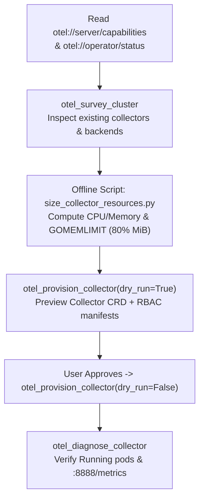
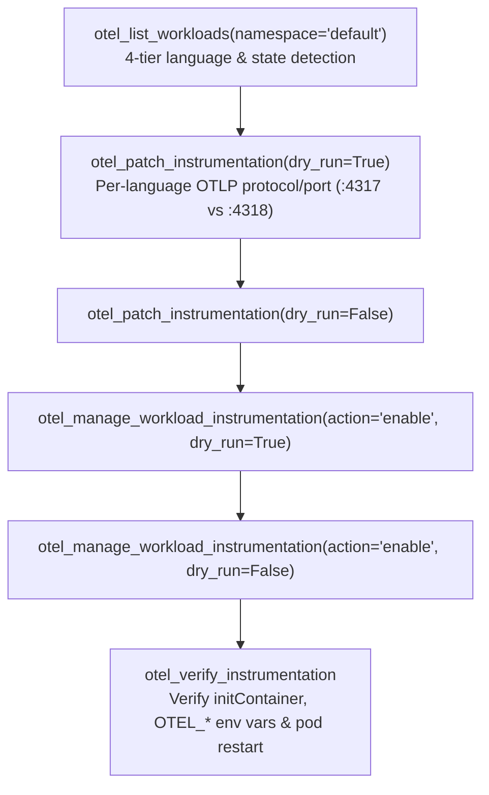

# OpenTelemetry MCP Server — End-to-End Observability Journeys

This guide shows how the **7 Agent Skills (Knowledge Layer)** and **17 MCP Tools + 14 Live Resources (Execution Layer)** coordinate across production OpenTelemetry workflows on Kubernetes.

---

## Workflow 1: Provisioning OpenTelemetry Collectors (`provisioning-opentelemetry-collectors`)

1. **Preconditions**: Read `otel://server/capabilities` and `otel://operator/status`.
2. **Survey**: Call `otel_survey_cluster(namespaces=["observability"])` to detect existing collectors and backends.
3. **Preview**: Call `otel_provision_collector(namespace="observability", name="otel-agent", role="agent", signals=["traces", "metrics", "logs"], dry_run=True)`.
4. **Apply & Verify**: Call `otel_provision_collector(..., dry_run=False)` after user approval, then verify with `otel_diagnose_collector(namespace="observability", name="otel-agent")`.

---

## Workflow 2: Instrumenting Kubernetes Workloads (`instrumenting-kubernetes-workloads`)

1. **Discover Workloads**: Call `otel_list_workloads(namespace="default")` to inspect `Deployment`, `StatefulSet`, and `DaemonSet` workloads.
2. **Configure Instrumentation CR**: Call `otel_patch_instrumentation(namespace="default", name="default-otel", collector_endpoint="http://otel-collector.observability.svc:4318", languages=["java", "python"], dry_run=True)` — automatically sets `:4317` (`grpc`) for Java/Node.js and `:4318` (`http/protobuf`) for Python/.NET/Go.
3. **Inject Workload**: Call `otel_manage_workload_instrumentation(namespace="default", workload_name="checkout", workload_kind="Deployment", action="enable", language="java", dry_run=True)`.
4. **Verify**: Call `otel_verify_instrumentation(namespace="default", workload_name="checkout", workload_kind="Deployment")`.

---

## Workflow 3: Troubleshooting Telemetry Pipelines (`troubleshooting-telemetry-pipelines`)

1. **Single-Call Diagnosis**: Call `otel_diagnose_collector(namespace="observability", name="otel-gateway")` to correlate CR status, pod `OOMKilled`/`CrashLoopBackOff` states, Service endpoints, namespace events, redacted error logs, and internal Prometheus telemetry (`:8888/metrics`).
2. **Deep Static + Live Validation**: Call `otel_validate_collector_config(namespace="observability", name="otel-gateway")`.
3. **One-Click Rollback**: Inspect `otel://collector/observability/otel-gateway/history` and call `otel_revert_collector_config(namespace="observability", name="otel-gateway", dry_run=True)`.

---

## Workflow 4: Tuning Sampling & Trace-Derived Metrics (`tuning-sampling-and-trace-derived-metrics`)

1. **Inspect Sampling**: Read `otel://sampling/observability/otel-gateway` and `otel://spanmetrics/observability/otel-gateway`.
2. **Enable Bounded Connectors**: Call `otel_configure_connectors(namespace="observability", collector_name="otel-gateway", connectors=["spanmetrics", "servicegraph"], connector_options={"dimensions": ["http.request.method", "http.response.status_code"]}, dry_run=True)`.
3. **Configure Sampling**: Call `otel_configure_sampling(namespace="observability", collector_name="otel-gateway", strategy="probabilistic", sampling_options={"sample_rate": 0.25}, dry_run=True)`. Note: `strategy="tail"` is automatically guarded against running on DaemonSet or multi-replica collectors without `has_load_balancing_exporter=True`.

---

## Workflow 5: Controlling Telemetry Cardinality & Noise (`controlling-telemetry-cardinality-and-noise`)

1. **Inspect Profiles**: Read `otel://spanmetrics/{namespace}/{collector}` and `otel://logs-profile/{namespace}/{collector}`.
2. **Estimate Impact Offline**: Run `skills/controlling-telemetry-cardinality-and-noise/scripts/estimate_series_cardinality.py`.
3. **Apply OTTL Filtering & Attribute Dropping**: Call `otel_configure_processing(namespace="observability", collector_name="otel-gateway", signals=["logs", "traces", "metrics"], rules={"parse_json": True, "drop_attributes": ["http.user_agent", "url.query"], "drop_noise_paths": ["/healthz", "/readyz", "/metrics"]}, dry_run=True)`.

---

## Workflow 6: Auditing Observability Security Posture (`auditing-observability-security-posture`)

1. **Cluster-Wide Security Audit**: Call `otel_audit_security_posture(namespace="observability")` to detect plaintext secrets (`SEC_INLINE_SECRET`), unencrypted exporters (`SEC_INSECURE_EXPORTER`), wildcard RBAC (`SEC_OVERPERMISSIVE_RBAC`), and privileged eBPF/OBI pods (`SEC_PRIVILEGED_CONTAINER`, `SEC_EBPF_EXCESS_CAPS`).
2. **Remediate PII in Logs/Traces**: Call `otel_configure_processing(namespace="observability", collector_name="otel-gateway", rules={"mask_pii": ["email", "credit_card", "ssn", "jwt", "bearer_token"]}, dry_run=True)`.

---

## Workflow 7: Upgrading OpenTelemetry Components (`upgrading-opentelemetry-components`)

1. **Offline Deprecation Scan**: Run `skills/upgrading-opentelemetry-components/scripts/diff_collector_breaking_changes.py` against `otel://collector/{namespace}/{name}/config`.
2. **Validate Against Target Version**: Call `otel_validate_collector_config(namespace="observability", name="otel-gateway", target_version="0.152.1")`.
3. **Apply Upgrade**: Call `otel_patch_collector(namespace="observability", name="otel-gateway", config_yaml=..., workload_options={"image": "otel/opentelemetry-collector-contrib:0.152.1"}, dry_run=True)` and use `otel_revert_collector_config` if rollback is needed.
